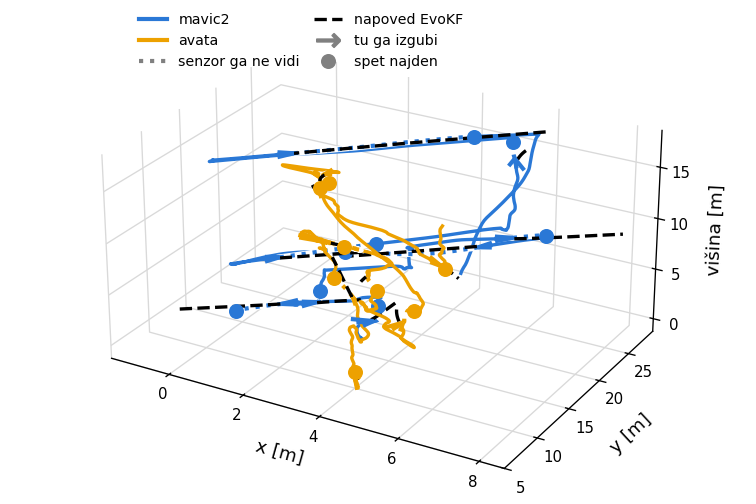
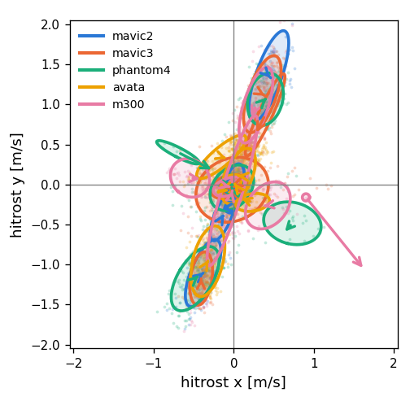

# evokf drones

tracking drones with evolving models. kalman filter + swarms: one model learns how each drone
flies (regression, to continue the path when the sensor loses it), one learns what makes the
drones different (classifier). both learn online.

dataset: MMAUD, https://github.com/ntu-aris/MMAUD (CC BY-NC-SA 4.0)
- download: `python/download_mmaud.py` or `matlab/download_mmaud.m`, goes into `data/`

main code python: `python/behaviour.py`, model in `python/evokf.py`

main code matlab: `matlab/behaviour.m`, model in `matlab/Swarms.m` and `matlab/EvoKF.m`

